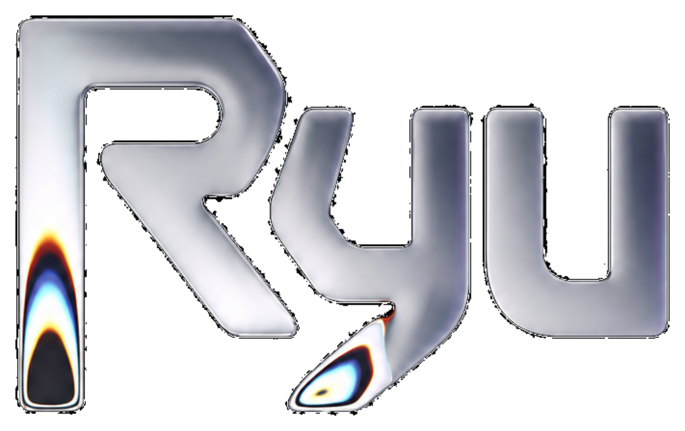
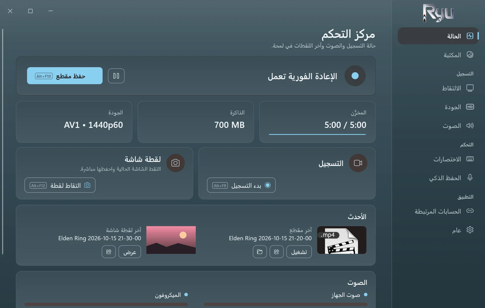
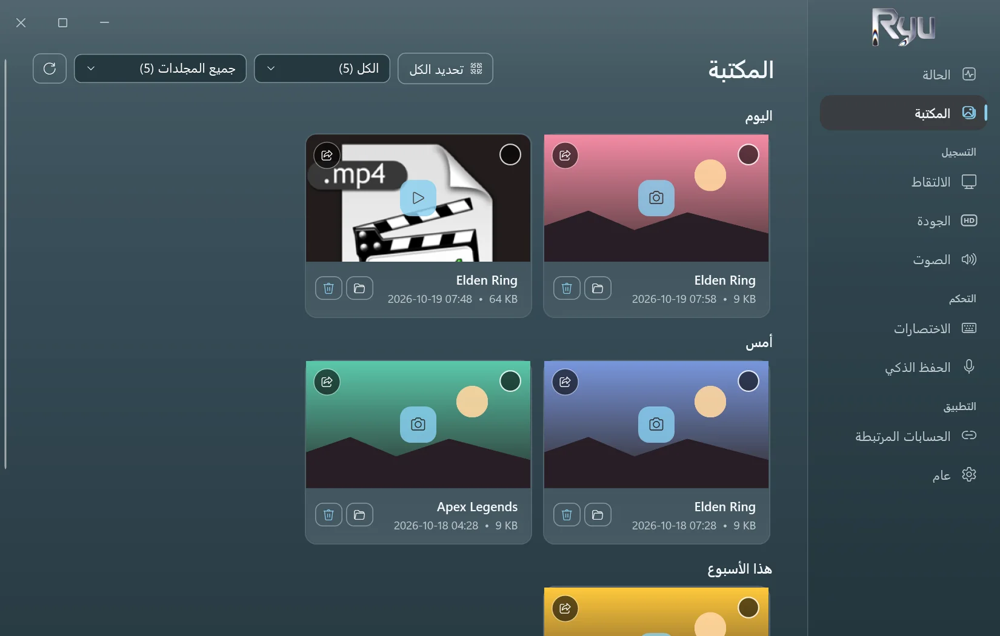
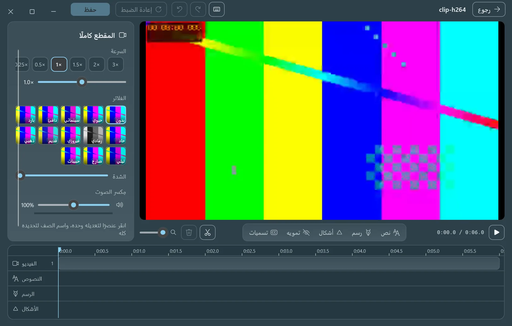
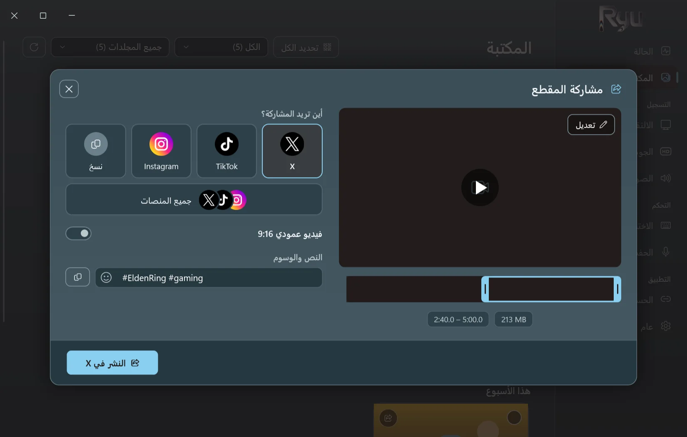
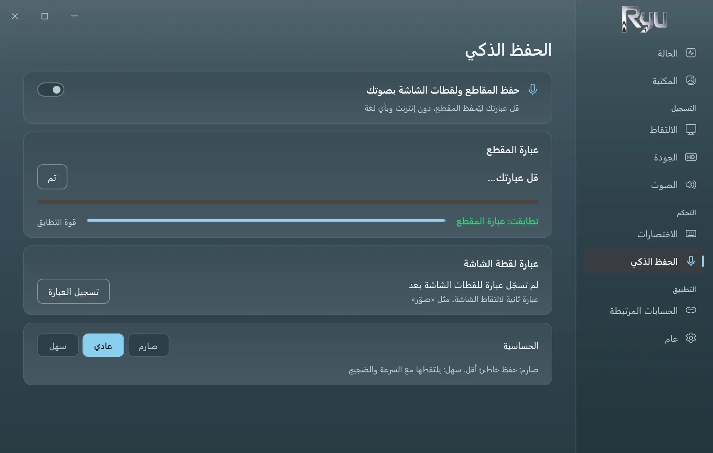
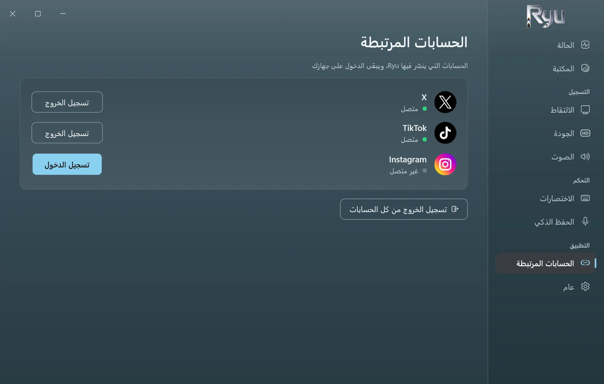

<p align="center">
  <picture>
    <source media="(prefers-color-scheme: dark)" srcset="../src/Ryu/Ui/Assets/ryu-logo.png">
    
  </picture>
</p>

<h3 align="center">الإعادة الفورية لألعاب ويندوز.</h3>

<p align="center" dir="rtl">
  اضغط مفتاحًا أو قل عبارتك، فتُحفظ آخر خمس دقائق.<br>
  مجاني ومفتوح المصدر، يعمل دون إنترنت، وخفيف لدرجة أنك ستنسى أنه يعمل.
</p>

<p align="center">
  <a href="https://github.com/D3N00N/Ryu-Replay/releases/latest"></a>
  
  
</p>

<p align="center">
  <a href="../README.md">English</a> ·
  <b>العربية</b> ·
  <a href="README.zh-Hans.md">简体中文</a> ·
  <a href="README.ru.md">Русский</a> ·
  <a href="README.es.md">Español</a> ·
  <a href="README.pt-BR.md">Português (Brasil)</a> ·
  <a href="README.de.md">Deutsch</a>
</p>

https://github.com/user-attachments/assets/c7afb475-f4a2-4356-acc5-327935e879e2

<div dir="rtl">

## حول Ryu

- **لا تفوتك اللحظة.** يحتفظ Ryu في الذاكرة بآخر 15 ثانية إلى 20 دقيقة (5 دقائق افتراضيًا). اضغط `Alt+F10` فتصبح مقطعًا.
- **الحفظ الذكي.** سجّل عبارة من اختيارك، بأي لغة أو لهجة، ثم قلها لحفظ مقطع أو التقاط لقطة شاشة. يعمل دون إنترنت.
- **خفيف.** يسجّل على بطاقة الرسوميات. قِيس أثناء تشغيل لعبة بدقة 1440p60 وترميز AV1:‏ 0.4% من المعالج، دون أي إطار مفقود.
- **حرّر في مكانه.** قُصّ، وغيّر السرعة، وأضف نصًا، وارسم، وطمّس، واصنع تسميات توضيحية تلقائية على جهازك.
- **شارك بضغطة.** انشر على X وتيك توك وإنستغرام، أو على الثلاثة معًا بوصف واحد، أو انسخ المقطع والصقه أينما شئت.
- **خصوصية.** لا حساب ولا تتبّع. تبقى مقاطعك على جهازك حتى تشاركها.

## لقطات الشاشة

<table>
  <tr>
    <td width="50%"><p align="center"><sub>الإعادة الفورية والتسجيل ولقطات الشاشة في لمحة</sub></p></td>
    <td width="50%"><p align="center"><sub>كل مقاطعك ولقطاتك، حسب اليوم وحسب اللعبة</sub></p></td>
  </tr>
  <tr>
    <td width="50%"><p align="center"><sub>المحرر، مع تسميات توضيحية تلقائية تُصنع على جهازك</sub></p></td>
    <td width="50%"><p align="center"><sub>ينشر على X وتيك توك وإنستغرام نيابةً عنك</sub></p></td>
  </tr>
  <tr>
    <td width="50%"><p align="center"><sub>الحفظ الذكي: قل عبارتك ليُحفظ المقطع</sub></p></td>
    <td width="50%"><p align="center"><sub>سجّل الدخول مرة واحدة، وتبقى بيانات الدخول على جهازك</sub></p></td>
  </tr>
</table>

## التنزيل

1. نزّل **Ryu-Setup.exe** من [أحدث إصدار](https://github.com/D3N00N/Ryu-Replay/releases/latest).
2. شغّله واتبع الخطوات: اختر اللغة ومجلد التثبيت (دون صلاحيات المسؤول)، وهل تريد اختصارًا على سطح المكتب وتشغيل Ryu مع ويندوز.
3. العب، واضغط `Alt+F10` حين يحدث ما يستحق.

قد يحذّرك ويندوز من ناشر غير معروف (المثبّت غير موقَّع بعد): اختر **مزيد من المعلومات** ثم **تشغيل على أي حال**.
تصل التحديثات من داخل البرنامج، ولا تُثبَّت أثناء التسجيل أبدًا. وإزالة البرنامج تُبقي مقاطعك وإعداداتك.

**المتطلبات:** ويندوز 10 (الإصدار 2004 أو أحدث) أو ويندوز 11، بنظام 64 بت. يُفضَّل وجود بطاقة رسوميات بمرمِّز فيديو (NVIDIA أو AMD أو Intel).

## الميزات

<details>
<summary>كل ما يقدّمه Ryu</summary>

- **الالتقاط:** الشاشة كاملة، أو نافذة واحدة، أو الألعاب (تُكتشف تلقائيًا)، حتى 4K وبمعدل 30 إلى 240 إطارًا في الثانية.
- **الترميز:** AV1 أو HEVC أو H.264 على NVIDIA (NVENC) أو AMD (AMF) أو Intel (Quick Sync)، مع x264 بديلًا.
- **الصوت:** صوت النظام والميكروفون، مع خيار فصلهما في مسارات مستقلة.
- **التسجيل:** ابدأ وأوقف مؤقتًا وأنهِ بالاختصارات، ويبقى التسجيل الموقوف مؤقتًا ملفًا واحدًا.
- **لقطات الشاشة** باختصار خاص، وتُحفظ بجانب مقاطعك.
- **المكتبة:** المقاطع واللقطات حسب اليوم، مع تصفية حسب اللعبة، وحدّ لحجم المجلد ينقل الأقدم إلى سلة المحذوفات.
- **المحرر:** قصّ ودمج، وسرعة وصوت لكل جزء، ونصوص بخطوط وأنماط متعددة، وتسميات توضيحية تلقائية، ورسم، وأشكال، وتطميس، ومرشحات، واقتصاص للقطات الشاشة.
- **التسميات التوضيحية التلقائية:** Whisper على بطاقة الرسوميات. يُنزَّل المحرك والنموذج مرة واحدة بعد موافقتك، ويمكن حذفهما من الإعدادات.
- **المشاركة:** على X أو تيك توك أو إنستغرام أو جميعها، عبر صفحة كل موقع نفسه، مع القص على شريط الإطارات والاقتصاص بنسبة 9:16.
- **سبع لغات:** العربية والإنجليزية والصينية والروسية والإسبانية والبرتغالية والألمانية، ويتبع التشغيل الأول لغة ويندوز.
- **هادئ:** يبدأ مع ويندوز في منطقة الإعلامات، دون نوافذ منبثقة أو أصوات ما لم تفعّلها.

</details>

## الخصوصية

- لا قياس عن بُعد، ولا تحليلات، ولا حساب لدى Ryu.
- لا يتصل Ryu بالإنترنت إلا حين تطلب: لنشر ما تشاركه، ولتنزيل التسميات التوضيحية التلقائية مرة واحدة، وللتحقق من وجود إصدار أحدث مرة يوميًا (ويمكنك إيقاف ذلك).
- يعمل الحفظ الذكي والتسميات التوضيحية التلقائية على جهازك فقط.

## البناء من المصدر

<details>
<summary>للمطوّرين</summary>

Ryu تطبيق ‎.NET 10 (WPF وWinForms) يستضيف **libobs**، محرك [OBS Studio](https://obsproject.com)، بالوحدات التي يحتاجها فقط، ويستخدم FFmpeg للتحرير والمشاركة.

<div dir="ltr">

```powershell
.\tools\build-whisper.ps1               # once: the auto captions engine (needs the Vulkan SDK and VS Build Tools)
.\tools\release.ps1                     # the Setup, update files and source zip in releases\ (needs vpk 1.2.161)
dotnet run --project tests\Ryu.Tests # the tests
```

</div>

ينسخ البناء libobs 32.2.2 من OBS Studio مثبّت على الجهاز.

</details>

## الترخيص

Ryu برنامج حر مرخَّص بموجب [رخصة جنو العمومية العامة، الإصدار 2.0 أو أحدث](../LICENSE)، وهي رخصة libobs نفسها. يأتي كل إصدار مع شيفرته المصدرية كاملة، والمكوّنات الخارجية وتراخيصها مذكورة في [THIRD-PARTY-NOTICES.md](../THIRD-PARTY-NOTICES.md).

<sub>كلمة *Ryu* (καιρός) يونانية تعني *اللحظة المناسبة*.</sub>

</div>
