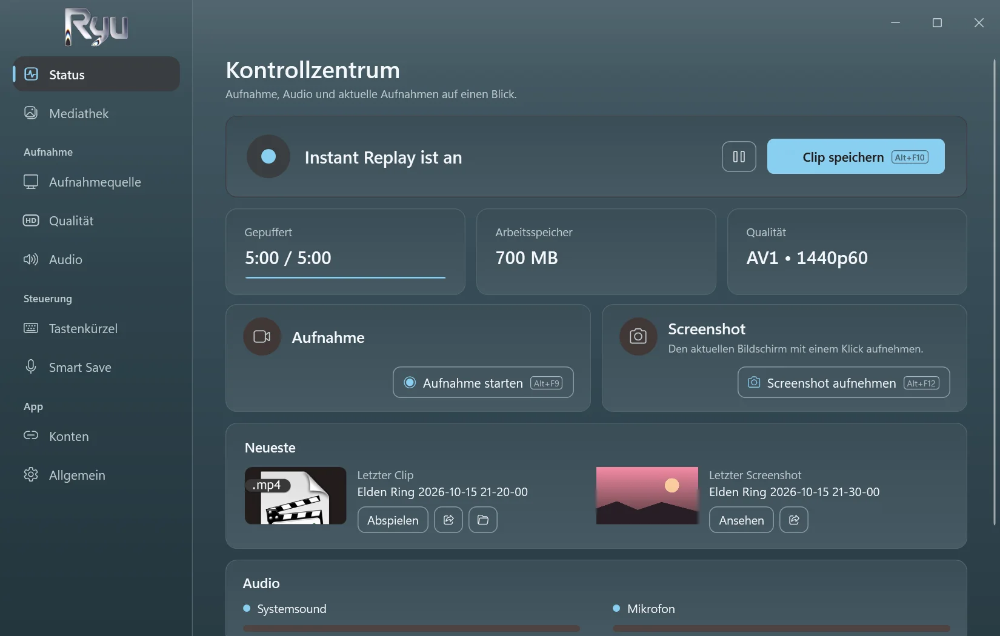
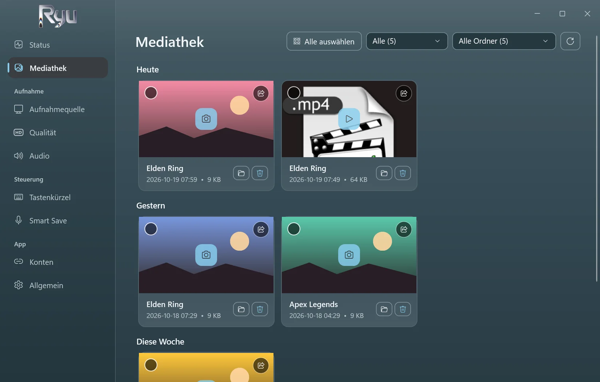
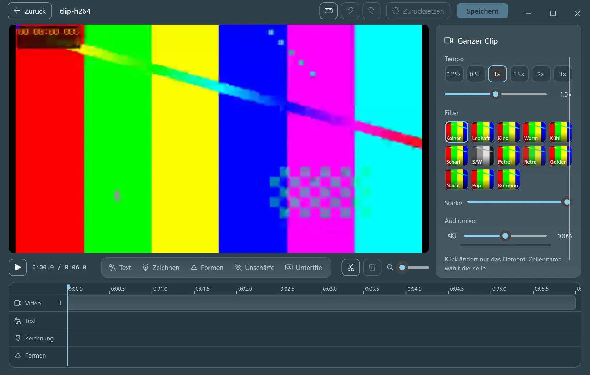
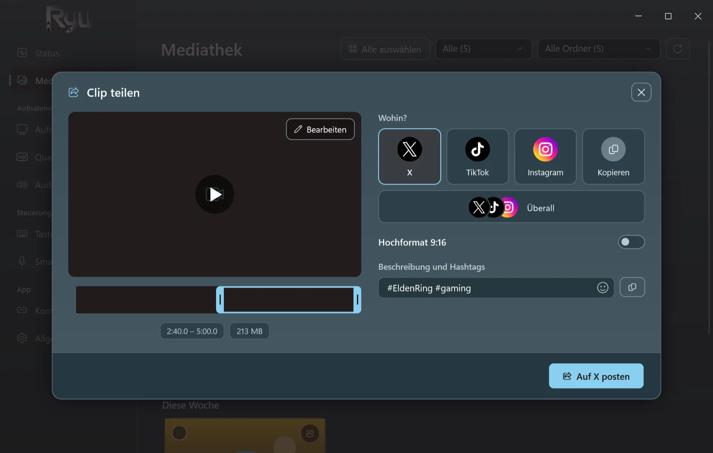
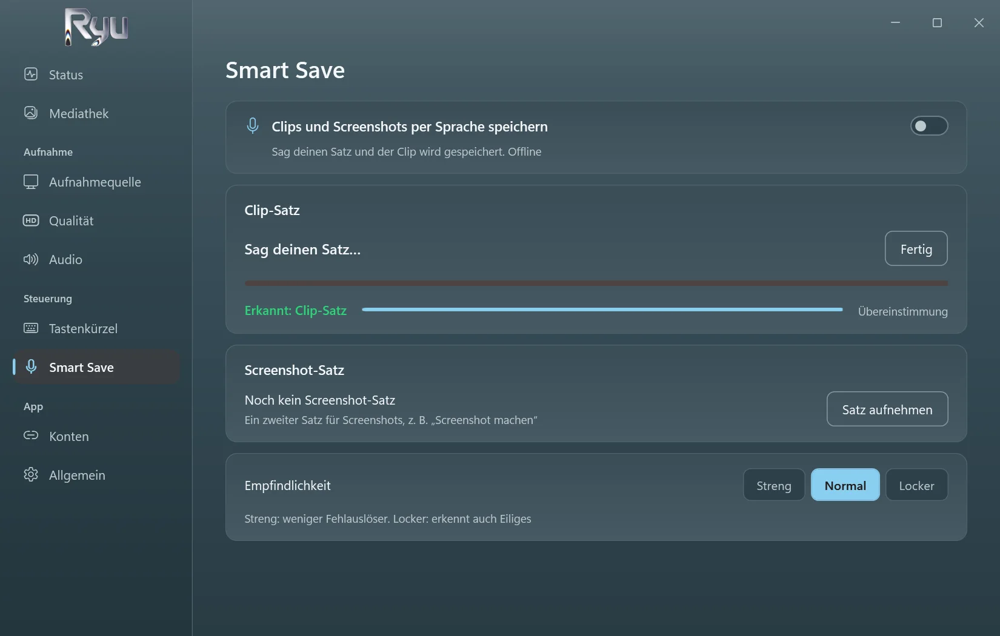
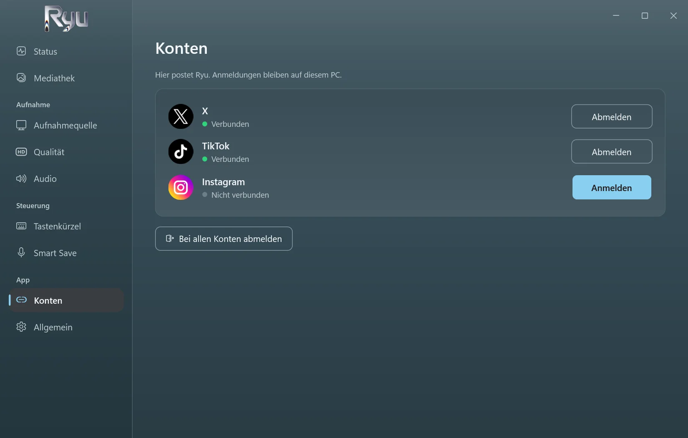

<p align="center">
  <picture>
    <source media="(prefers-color-scheme: dark)" srcset="../src/Ryu/Ui/Assets/ryu-logo.png">
    
  </picture>
</p>

<h3 align="center">Instant Replay für Windows-Spiele.</h3>

<p align="center">
  Drück eine Taste oder sag deinen Satz – und die letzten fünf Minuten sind gespeichert.<br>
  Kostenlos, Open Source, offline und so leicht, dass du vergisst, dass es läuft.
</p>

<p align="center">
  <a href="https://github.com/D3N00N/Ryu-Replay/releases/latest"></a>
  
  
</p>

<p align="center">
  <a href="../README.md">English</a> ·
  <a href="README.ar.md">العربية</a> ·
  <a href="README.zh-Hans.md">简体中文</a> ·
  <a href="README.ru.md">Русский</a> ·
  <a href="README.es.md">Español</a> ·
  <a href="README.pt-BR.md">Português (Brasil)</a> ·
  <b>Deutsch</b>
</p>

https://github.com/user-attachments/assets/c7afb475-f4a2-4356-acc5-327935e879e2

## Warum Ryu

- **Verpass keinen Moment.** Ryu hält die letzten 15 Sekunden bis 20 Minuten im Speicher (standardmäßig 5). Drück `Alt+F10`, und daraus wird ein Clip.
- **Smart Save.** Nimm einen eigenen Satz auf, in jeder Sprache, und sag ihn einfach, um einen Clip zu speichern oder einen Screenshot aufzunehmen. Läuft offline.
- **Leicht.** Aufgenommen wird auf der Grafikkarte. Gemessen mit einem laufenden Spiel in 1440p60 AV1: 0,4 % CPU, keine verlorenen Frames.
- **Direkt bearbeiten.** Schneiden, Tempo ändern, Text einfügen, zeichnen, weichzeichnen und automatische Untertitel auf deinem eigenen PC erstellen.
- **Teilen mit einem Klick.** Poste auf X, TikTok und Instagram oder auf allen dreien mit einer Beschreibung – oder kopiere den Clip und füge ihn überall ein.
- **Privat.** Kein Konto, keine Telemetrie. Deine Clips bleiben auf deinem PC, bis du sie teilst.

## Screenshots

<table>
  <tr>
    <td width="50%"><p align="center"><sub>Instant Replay, Aufnahme und Screenshots auf einen Blick</sub></p></td>
    <td width="50%"><p align="center"><sub>Alle Clips und Screenshots, nach Tag und Spiel</sub></p></td>
  </tr>
  <tr>
    <td width="50%"><p align="center"><sub>Der Editor mit automatischen Untertiteln, erstellt auf deinem PC</sub></p></td>
    <td width="50%"><p align="center"><sub>Postet für dich auf X, TikTok und Instagram</sub></p></td>
  </tr>
  <tr>
    <td width="50%"><p align="center"><sub>Smart Save: sag deinen Satz zum Speichern</sub></p></td>
    <td width="50%"><p align="center"><sub>Einmal anmelden – die Anmeldungen bleiben auf deinem PC</sub></p></td>
  </tr>
</table>

## Download

1. Lade **Ryu-Setup.exe** aus dem [neuesten Release](https://github.com/D3N00N/Ryu-Replay/releases/latest) herunter.
2. Starte sie und folge den Schritten: Wähle Sprache und Ordner (ohne Administratorrechte) und ob du eine Desktop-Verknüpfung möchtest und Ryu mit Windows starten soll.
3. Spiel und drück `Alt+F10`, wenn etwas passiert.

Windows warnt eventuell vor einem unbekannten Herausgeber (der Installer ist noch nicht signiert): wähle **Weitere Informationen** und dann **Trotzdem ausführen**.
Updates kommen direkt in der App und nie während einer Aufnahme. Beim Deinstallieren bleiben deine Clips und Einstellungen erhalten.

**Voraussetzungen:** Windows 10 (2004 oder neuer) oder Windows 11, 64 Bit. Empfohlen wird eine Grafikkarte mit Video-Encoder (NVIDIA, AMD oder Intel).

## Funktionen

<details>
<summary>Alles, was Ryu kann</summary>

- **Aufnahme:** ganzer Bildschirm, ein Fenster oder Spiele (automatisch erkannt), bis 4K bei 30 bis 240 fps.
- **Encoding:** AV1, HEVC oder H.264 auf NVIDIA (NVENC), AMD (AMF) oder Intel (Quick Sync), mit x264 als Ausweichlösung.
- **Audio:** Systemsound und Mikrofon, auf Wunsch in getrennten Spuren.
- **Aufnahmen:** mit Tastenkürzeln starten, pausieren und stoppen; eine pausierte Aufnahme bleibt eine Datei.
- **Screenshots** mit eigenem Tastenkürzel, gespeichert neben deinen Clips.
- **Mediathek:** Clips und Screenshots nach Tag, nach Spiel filterbar, mit einem Größenlimit für den Ordner, das die ältesten in den Papierkorb verschiebt.
- **Editor:** schneiden und zusammenfügen, Tempo und Ton pro Teil, Text in vielen Schriften und Stilen, automatische Untertitel, Zeichnen, Formen, Weichzeichnen, Filter und Zuschneiden von Screenshots.
- **Automatische Untertitel:** Whisper auf deiner Grafikkarte. Engine und Modell werden einmal heruntergeladen, nachdem du zugestimmt hast, und lassen sich in den Einstellungen entfernen.
- **Teilen:** X, TikTok, Instagram oder alle, über die eigene Seite jeder Plattform; auf einem Bildstreifen kürzen und auf 9:16 zuschneiden.
- **Sieben Sprachen:** Englisch, Arabisch, Chinesisch, Russisch, Spanisch, Portugiesisch und Deutsch. Beim ersten Start folgt Ryu der Windows-Sprache.
- **Leise:** startet mit Windows im Infobereich, ohne Pop-ups oder Töne, außer du schaltest sie ein.

</details>

## Datenschutz

- Keine Telemetrie, keine Analysen, kein Ryu-Konto.
- Ryu geht nur online, wenn du es willst: um zu posten, was du teilst, um die automatischen Untertitel einmal herunterzuladen und um einmal am Tag nach einer neuen Version zu suchen (abschaltbar).
- Smart Save und automatische Untertitel hören nur auf deinem PC zu.

## Aus dem Quellcode bauen

<details>
<summary>Für Entwickler</summary>

Ryu ist eine .NET-10-App (WPF und WinForms), die **libobs**, die Engine von [OBS Studio](https://obsproject.com), nur mit den nötigen Modulen einbindet und FFmpeg zum Bearbeiten und Teilen nutzt.

```powershell
.\tools\build-whisper.ps1               # once: the auto captions engine (needs the Vulkan SDK and VS Build Tools)
.\tools\release.ps1                     # the Setup, update files and source zip in releases\ (needs vpk 1.2.161)
dotnet run --project tests\Ryu.Tests # the tests
```

Der Build kopiert libobs 32.2.2 aus einem installierten OBS Studio.

</details>

## Lizenz

Ryu ist freie Software unter der [GNU General Public License v2.0 oder neuer](../LICENSE), derselben Lizenz wie libobs. Jedes Release enthält den vollständigen Quellcode. Komponenten von Drittanbietern und ihre Lizenzen stehen in [THIRD-PARTY-NOTICES.md](../THIRD-PARTY-NOTICES.md).

<sub>*Ryu* (καιρός) ist griechisch für *der richtige Moment*.</sub>
