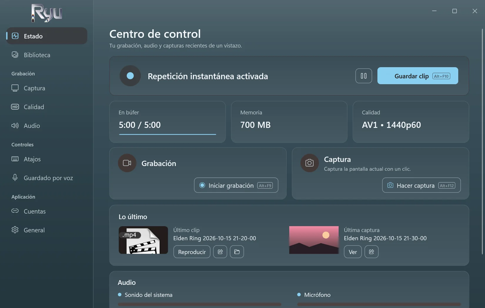
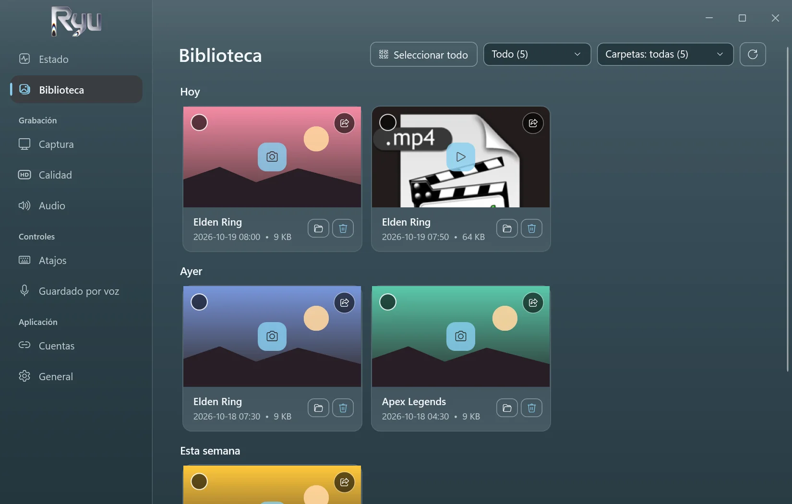
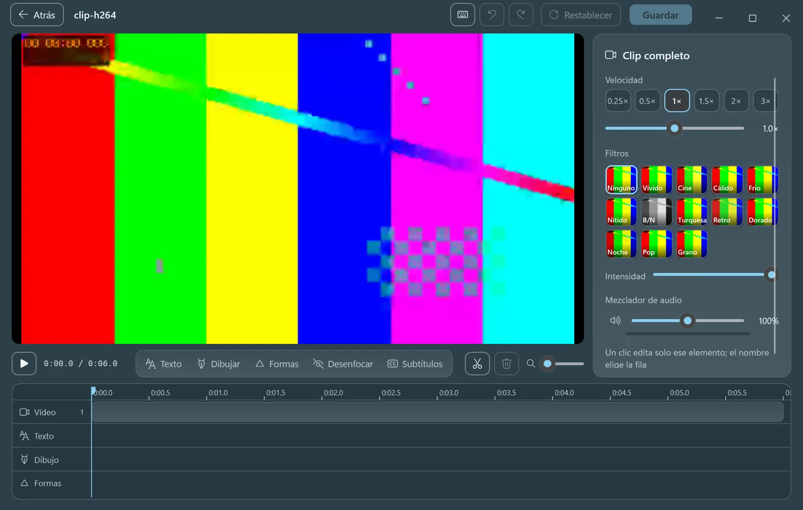
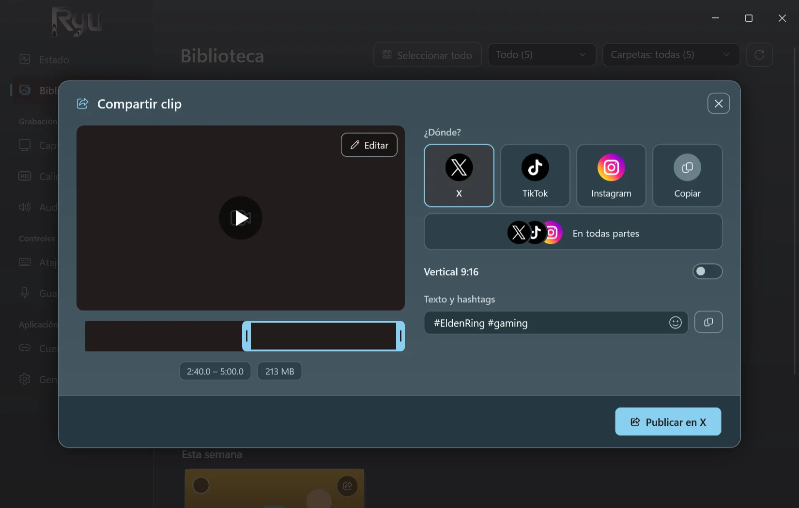
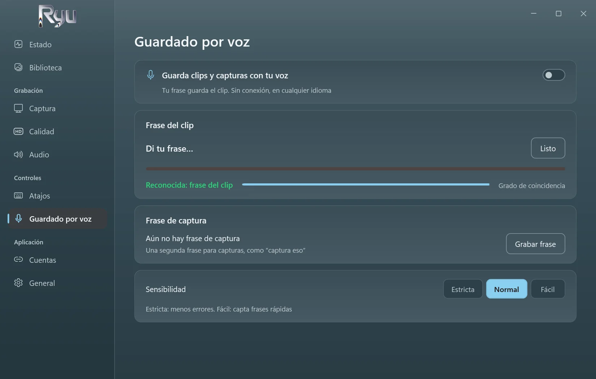
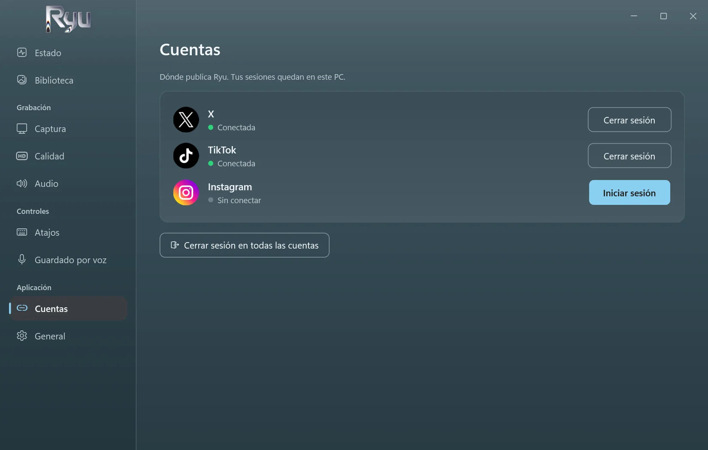

<p align="center">
  <picture>
    <source media="(prefers-color-scheme: dark)" srcset="../src/Ryu/Ui/Assets/ryu-logo.png">
    
  </picture>
</p>

<h3 align="center">Repetición instantánea para juegos de Windows.</h3>

<p align="center">
  Pulsa una tecla o di tu frase, y se guardan los últimos cinco minutos.<br>
  Gratis, de código abierto, sin conexión y tan ligero que olvidarás que está activo.
</p>

<p align="center">
  <a href="https://github.com/D3N00N/Ryu-Replay/releases/latest"></a>
  
  
</p>

<p align="center">
  <a href="../README.md">English</a> ·
  <a href="README.ar.md">العربية</a> ·
  <a href="README.zh-Hans.md">简体中文</a> ·
  <a href="README.ru.md">Русский</a> ·
  <b>Español</b> ·
  <a href="README.pt-BR.md">Português (Brasil)</a> ·
  <a href="README.de.md">Deutsch</a>
</p>

https://github.com/user-attachments/assets/c7afb475-f4a2-4356-acc5-327935e879e2

## ¿Por qué Ryu?

- **No te pierdas el momento.** Ryu guarda en memoria los últimos 15 segundos a 20 minutos (5 por defecto). Pulsa `Alt+F10` y se convierte en un clip.
- **Guardado por voz.** Graba una frase propia, en cualquier idioma, y luego solo dila para guardar un clip o hacer una captura. Funciona sin conexión.
- **Ligero.** Graba con tu tarjeta gráfica. Medido con un juego a 1440p60 AV1: 0,4 % de CPU y ningún fotograma perdido.
- **Edita al momento.** Recorta, cambia la velocidad, añade texto, dibuja, difumina y crea subtítulos automáticos en tu propio PC.
- **Comparte con un clic.** Publica en X, TikTok e Instagram, o en los tres a la vez con un solo texto, o copia el clip y pégalo donde quieras.
- **Privado.** Sin cuenta y sin telemetría. Tus clips se quedan en tu PC hasta que los compartes.

## Capturas

<table>
  <tr>
    <td width="50%"><p align="center"><sub>Repetición instantánea, grabación y capturas de un vistazo</sub></p></td>
    <td width="50%"><p align="center"><sub>Todos tus clips y capturas, por día y por juego</sub></p></td>
  </tr>
  <tr>
    <td width="50%"><p align="center"><sub>El editor, con subtítulos automáticos creados en tu PC</sub></p></td>
    <td width="50%"><p align="center"><sub>Publica en X, TikTok e Instagram por ti</sub></p></td>
  </tr>
  <tr>
    <td width="50%"><p align="center"><sub>Guardado por voz: di tu frase para guardar</sub></p></td>
    <td width="50%"><p align="center"><sub>Inicia sesión una vez; las sesiones se quedan en tu PC</sub></p></td>
  </tr>
</table>

## Descarga

1. Descarga **Ryu-Setup.exe** desde la [última versión](https://github.com/D3N00N/Ryu-Replay/releases/latest).
2. Ejecútalo y sigue los pasos: elige el idioma y la carpeta (sin permisos de administrador), y si quieres un acceso directo en el escritorio y que Ryu se inicie con Windows.
3. Juega y pulsa `Alt+F10` cuando pase algo.

Windows puede avisar de un editor desconocido (el instalador aún no está firmado): elige **Más información** y luego **Ejecutar de todas formas**.
Las actualizaciones llegan desde la propia app y nunca durante una grabación. Al desinstalar se conservan tus clips y tu configuración.

**Requisitos:** Windows 10 (2004 o posterior) o Windows 11, de 64 bits. Se recomienda una tarjeta gráfica con codificador de vídeo (NVIDIA, AMD o Intel).

## Funciones

<details>
<summary>Todo lo que hace Ryu</summary>

- **Captura:** pantalla completa, una ventana o juegos (detectados automáticamente), hasta 4K de 30 a 240 fps.
- **Codificación:** AV1, HEVC o H.264 en NVIDIA (NVENC), AMD (AMF) o Intel (Quick Sync), con x264 como respaldo.
- **Audio:** sonido del sistema y micrófono, opcionalmente en pistas separadas.
- **Grabación:** inicia, pausa y detén con atajos; una grabación pausada sigue siendo un solo archivo.
- **Capturas** con su propio atajo, guardadas junto a tus clips.
- **Biblioteca:** clips y capturas por día, filtrados por juego, con un límite de tamaño de carpeta que manda los más antiguos a la papelera de reciclaje.
- **Editor:** cortar y unir, velocidad y sonido por parte, texto con muchas fuentes y estilos, subtítulos automáticos, dibujo, formas, desenfoque, filtros y recorte para capturas.
- **Subtítulos automáticos:** Whisper en tu tarjeta gráfica. El motor y el modelo se descargan una vez, después de que aceptes, y se pueden quitar en Configuración.
- **Compartir:** X, TikTok, Instagram o todos, a través de la propia página de cada sitio; recorta en una tira de fotogramas y encuadra en 9:16.
- **Siete idiomas:** inglés, árabe, chino, ruso, español, portugués y alemán. La primera vez sigue el idioma de Windows.
- **Silencioso:** se inicia con Windows en la bandeja, sin ventanas emergentes ni sonidos salvo que los actives.

</details>

## Privacidad

- Sin telemetría, sin analíticas, sin cuenta de Ryu.
- Ryu solo se conecta cuando tú lo pides: para publicar lo que compartes, para descargar una vez los subtítulos automáticos y para buscar una versión nueva una vez al día (puedes desactivarlo).
- El guardado por voz y los subtítulos automáticos escuchan solo en tu PC.

## Compilar desde el código

<details>
<summary>Para desarrolladores</summary>

Ryu es una app de .NET 10 (WPF y WinForms) que integra **libobs**, el motor de [OBS Studio](https://obsproject.com), solo con los módulos que necesita, y usa FFmpeg para editar y compartir.

```powershell
.\tools\build-whisper.ps1               # once: the auto captions engine (needs the Vulkan SDK and VS Build Tools)
.\tools\release.ps1                     # the Setup, update files and source zip in releases\ (needs vpk 1.2.161)
dotnet run --project tests\Ryu.Tests # the tests
```

La compilación copia libobs 32.2.2 desde un OBS Studio instalado.

</details>

## Licencia

Ryu es software libre bajo la [Licencia Pública General de GNU v2.0 o posterior](../LICENSE), la misma licencia que libobs. Cada versión incluye su código fuente completo. Los componentes de terceros y sus licencias están en [THIRD-PARTY-NOTICES.md](../THIRD-PARTY-NOTICES.md).

<sub>*Ryu* (καιρός) significa *el momento oportuno* en griego.</sub>
