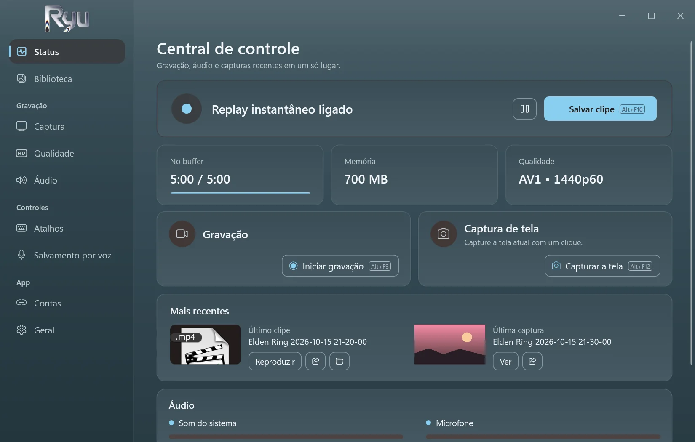
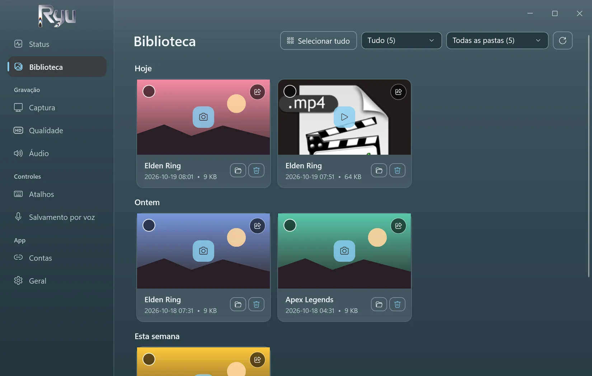
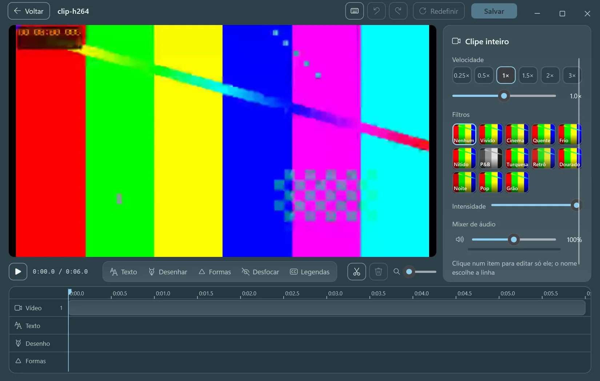
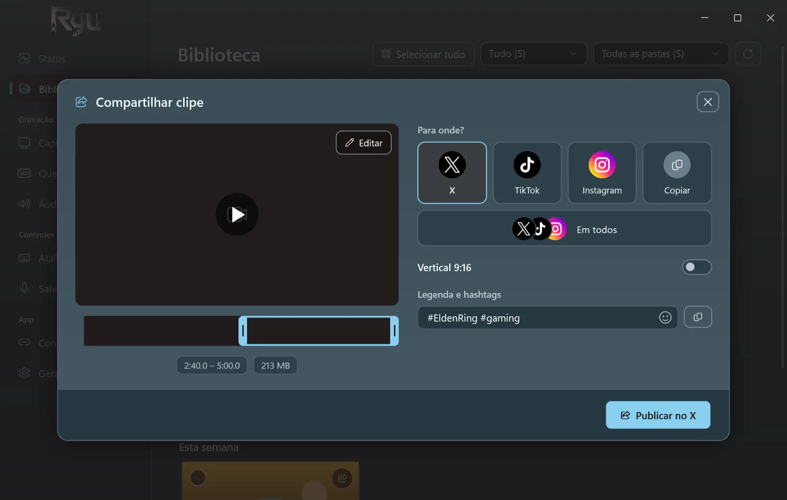
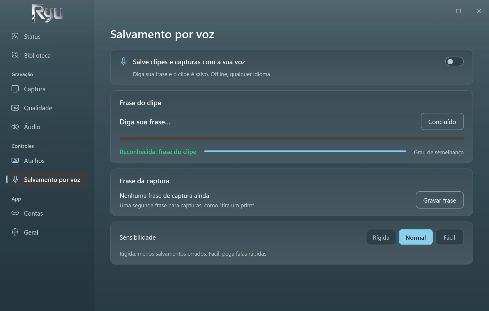
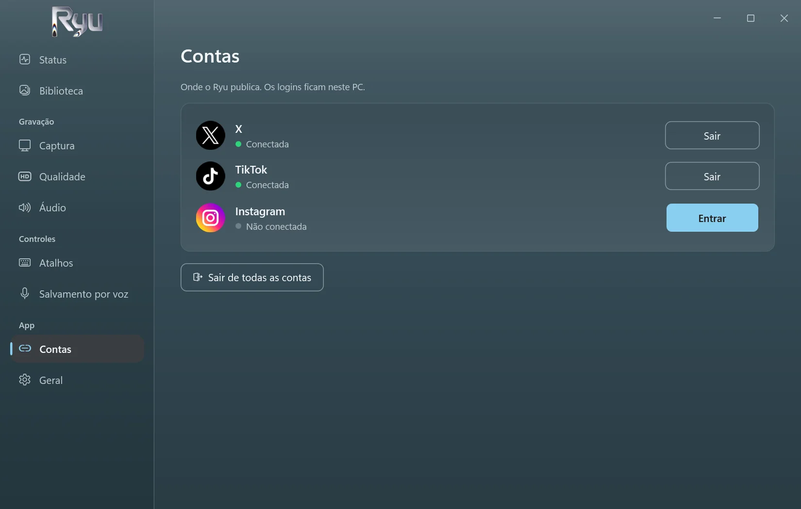

<p align="center">
  <picture>
    <source media="(prefers-color-scheme: dark)" srcset="../src/Ryu/Ui/Assets/ryu-logo.png">
    
  </picture>
</p>

<h3 align="center">Replay instantâneo para jogos no Windows.</h3>

<p align="center">
  Aperte uma tecla ou diga sua frase, e os últimos cinco minutos são salvos.<br>
  Grátis, de código aberto, offline e tão leve que você vai esquecer que está ligado.
</p>

<p align="center">
  <a href="https://github.com/D3N00N/Ryu-Replay/releases/latest"></a>
  
  
</p>

<p align="center">
  <a href="../README.md">English</a> ·
  <a href="README.ar.md">العربية</a> ·
  <a href="README.zh-Hans.md">简体中文</a> ·
  <a href="README.ru.md">Русский</a> ·
  <a href="README.es.md">Español</a> ·
  <b>Português (Brasil)</b> ·
  <a href="README.de.md">Deutsch</a>
</p>

https://github.com/user-attachments/assets/c7afb475-f4a2-4356-acc5-327935e879e2

## Por que o Ryu

- **Não perca o momento.** O Ryu mantém na memória os últimos 15 segundos a 20 minutos (5 por padrão). Aperte `Alt+F10` e vira um clipe.
- **Salvamento por voz.** Grave uma frase sua, em qualquer idioma, e depois é só dizê-la para salvar um clipe ou capturar a tela. Funciona offline.
- **Leve.** Grava pela placa de vídeo. Medido com um jogo rodando em 1440p60 AV1: 0,4% de CPU, sem quadros perdidos.
- **Edite na hora.** Corte, mude a velocidade, adicione texto, desenhe, desfoque e crie legendas automáticas no seu próprio PC.
- **Compartilhe com um clique.** Publique no X, no TikTok e no Instagram, ou nos três de uma vez com uma só legenda, ou copie o clipe e cole onde quiser.
- **Privado.** Sem conta e sem telemetria. Seus clipes ficam no seu PC até você compartilhar.

## Capturas de tela

<table>
  <tr>
    <td width="50%"><p align="center"><sub>Replay instantâneo, gravação e capturas num relance</sub></p></td>
    <td width="50%"><p align="center"><sub>Todos os seus clipes e capturas, por dia e por jogo</sub></p></td>
  </tr>
  <tr>
    <td width="50%"><p align="center"><sub>O editor, com legendas automáticas feitas no seu PC</sub></p></td>
    <td width="50%"><p align="center"><sub>Publica no X, TikTok e Instagram por você</sub></p></td>
  </tr>
  <tr>
    <td width="50%"><p align="center"><sub>Salvamento por voz: diga sua frase para salvar</sub></p></td>
    <td width="50%"><p align="center"><sub>Entre uma vez; os logins ficam no seu PC</sub></p></td>
  </tr>
</table>

## Download

1. Baixe o **Ryu-Setup.exe** na [versão mais recente](https://github.com/D3N00N/Ryu-Replay/releases/latest).
2. Execute e siga as etapas: escolha o idioma e a pasta (sem direitos de administrador), e se quer um atalho na área de trabalho e iniciar o Ryu com o Windows.
3. Jogue e aperte `Alt+F10` quando algo acontecer.

O Windows pode avisar sobre um editor desconhecido (o instalador ainda não é assinado): escolha **Mais informações** e depois **Executar assim mesmo**.
As atualizações chegam pelo próprio app e nunca durante uma gravação. Ao desinstalar, seus clipes e configurações são mantidos.

**Requisitos:** Windows 10 (2004 ou mais recente) ou Windows 11, 64 bits. Recomenda-se uma placa de vídeo com codificador de vídeo (NVIDIA, AMD ou Intel).

## Recursos

<details>
<summary>Tudo o que o Ryu faz</summary>

- **Captura:** tela inteira, uma janela ou jogos (detectados automaticamente), até 4K, de 30 a 240 fps.
- **Codificação:** AV1, HEVC ou H.264 em NVIDIA (NVENC), AMD (AMF) ou Intel (Quick Sync), com x264 como reserva.
- **Áudio:** som do sistema e microfone, opcionalmente em faixas separadas.
- **Gravação:** inicie, pause e pare com atalhos; uma gravação pausada continua sendo um só arquivo.
- **Capturas de tela** com atalho próprio, salvas ao lado dos clipes.
- **Biblioteca:** clipes e capturas por dia, filtrados por jogo, com limite de tamanho da pasta que manda os mais antigos para a Lixeira.
- **Editor:** cortar e juntar, velocidade e som por parte, texto em várias fontes e estilos, legendas automáticas, desenho, formas, desfoque, filtros e recorte de capturas.
- **Legendas automáticas:** Whisper na sua placa de vídeo. O motor e o modelo são baixados uma vez, depois que você concorda, e podem ser removidos nas Configurações.
- **Compartilhar:** X, TikTok, Instagram ou todos, pela própria página de cada site; corte numa faixa de quadros e enquadre em 9:16.
- **Sete idiomas:** inglês, árabe, chinês, russo, espanhol, português e alemão. A primeira execução segue o idioma do Windows.
- **Discreto:** inicia com o Windows na bandeja, sem pop-ups nem sons, a menos que você os ative.

</details>

## Privacidade

- Sem telemetria, sem análises, sem conta do Ryu.
- O Ryu só se conecta quando você pede: para publicar o que você compartilha, para baixar as legendas automáticas uma vez e para procurar uma versão nova uma vez por dia (dá para desativar).
- O salvamento por voz e as legendas automáticas escutam só no seu PC.

## Compilar a partir do código

<details>
<summary>Para desenvolvedores</summary>

O Ryu é um app .NET 10 (WPF e WinForms) que usa a **libobs**, o motor do [OBS Studio](https://obsproject.com), só com os módulos de que precisa, e o FFmpeg para editar e compartilhar.

```powershell
.\tools\build-whisper.ps1               # once: the auto captions engine (needs the Vulkan SDK and VS Build Tools)
.\tools\release.ps1                     # the Setup, update files and source zip in releases\ (needs vpk 1.2.161)
dotnet run --project tests\Ryu.Tests # the tests
```

A compilação copia a libobs 32.2.2 de um OBS Studio instalado.

</details>

## Licença

O Ryu é software livre sob a [Licença Pública Geral GNU v2.0 ou posterior](../LICENSE), a mesma licença da libobs. Cada versão inclui seu código-fonte completo. Os componentes de terceiros e suas licenças estão em [THIRD-PARTY-NOTICES.md](../THIRD-PARTY-NOTICES.md).

<sub>*Ryu* (καιρός) significa *o momento certo* em grego.</sub>
