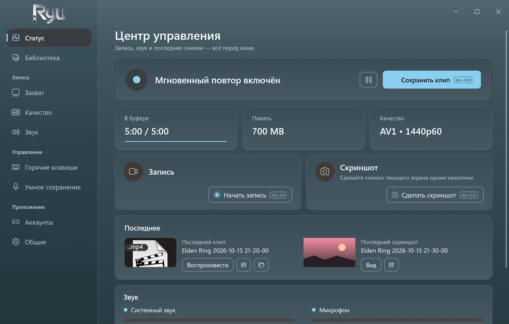
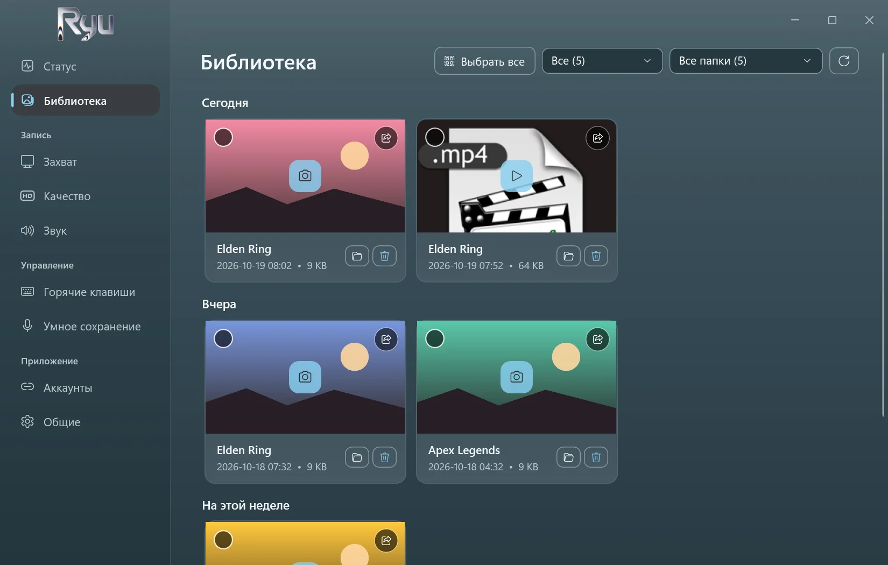
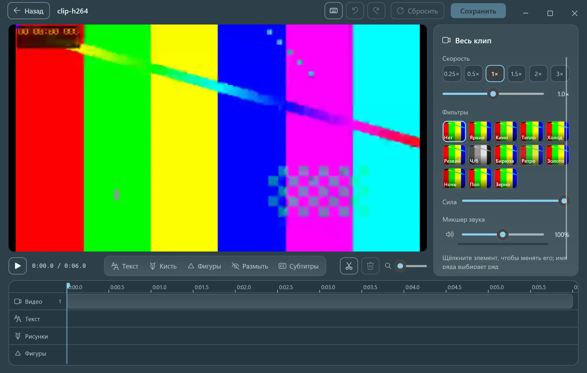
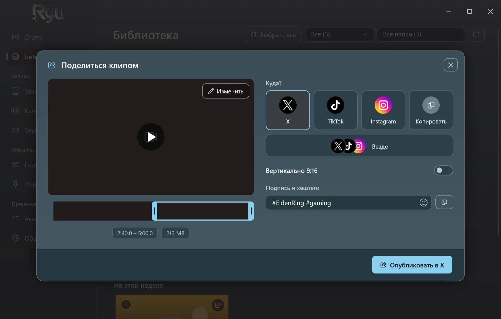
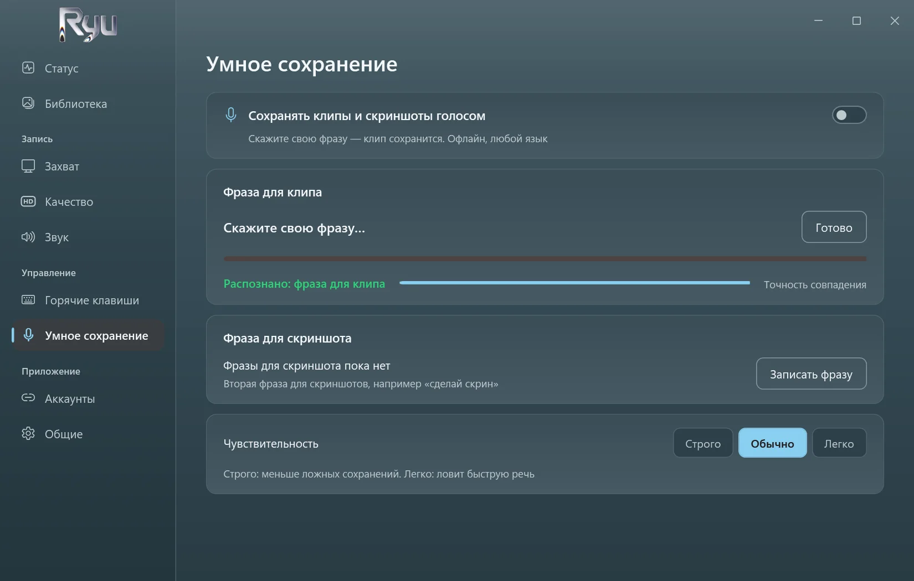
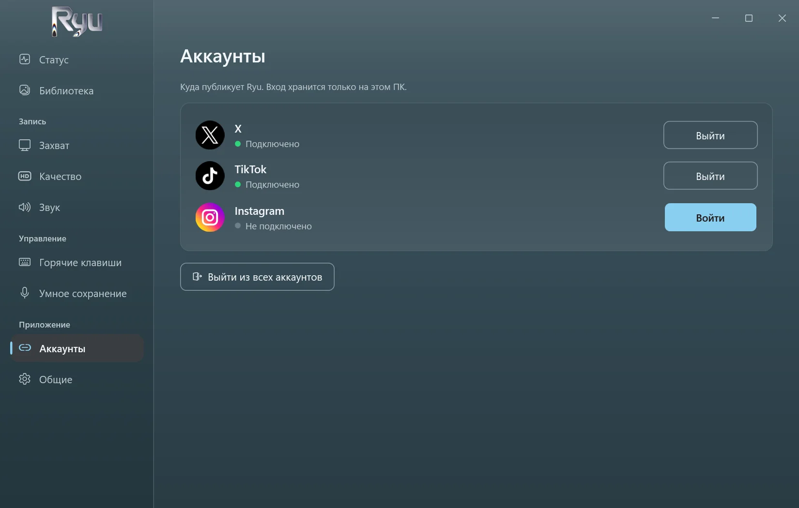

<p align="center">
  <picture>
    <source media="(prefers-color-scheme: dark)" srcset="../src/Ryu/Ui/Assets/ryu-logo.png">
    
  </picture>
</p>

<h3 align="center">Мгновенный повтор для игр на Windows.</h3>

<p align="center">
  Нажмите клавишу или скажите свою фразу — и последние пять минут сохранятся.<br>
  Бесплатно, с открытым кодом, без интернета и настолько легко, что вы забудете, что он работает.
</p>

<p align="center">
  <a href="https://github.com/D3N00N/Ryu-Replay/releases/latest"></a>
  
  
</p>

<p align="center">
  <a href="../README.md">English</a> ·
  <a href="README.ar.md">العربية</a> ·
  <a href="README.zh-Hans.md">简体中文</a> ·
  <b>Русский</b> ·
  <a href="README.es.md">Español</a> ·
  <a href="README.pt-BR.md">Português (Brasil)</a> ·
  <a href="README.de.md">Deutsch</a>
</p>

https://github.com/user-attachments/assets/c7afb475-f4a2-4356-acc5-327935e879e2

## Почему Ryu

- **Не упустите момент.** Ryu держит в памяти последние от 15 секунд до 20 минут (по умолчанию 5). Нажмите `Alt+F10` — и это станет клипом.
- **Умное сохранение.** Запишите свою фразу на любом языке, а потом просто скажите её, чтобы сохранить клип или сделать скриншот. Работает без интернета.
- **Лёгкий.** Записывает на видеокарте. Замер во время игры в 1440p60 AV1: 0,4% CPU, ни одного пропущенного кадра.
- **Редактируйте сразу.** Обрезайте, меняйте скорость, добавляйте текст, рисуйте, размывайте и создавайте автосубтитры прямо на своём ПК.
- **Публикация в одно нажатие.** Публикуйте в X, TikTok и Instagram или сразу во все три с одной подписью — либо скопируйте клип и вставьте куда угодно.
- **Приватность.** Без аккаунта и телеметрии. Клипы остаются на вашем ПК, пока вы ими не поделитесь.

## Скриншоты

<table>
  <tr>
    <td width="50%"><p align="center"><sub>Мгновенный повтор, запись и скриншоты — с первого взгляда</sub></p></td>
    <td width="50%"><p align="center"><sub>Все клипы и скриншоты — по дням и по играм</sub></p></td>
  </tr>
  <tr>
    <td width="50%"><p align="center"><sub>Редактор с автосубтитрами, созданными на вашем ПК</sub></p></td>
    <td width="50%"><p align="center"><sub>Публикует в X, TikTok и Instagram за вас</sub></p></td>
  </tr>
  <tr>
    <td width="50%"><p align="center"><sub>Умное сохранение: скажите фразу, чтобы сохранить</sub></p></td>
    <td width="50%"><p align="center"><sub>Войдите один раз — данные входа остаются на вашем ПК</sub></p></td>
  </tr>
</table>

## Скачать

1. Скачайте **Ryu-Setup.exe** из [последнего выпуска](https://github.com/D3N00N/Ryu-Replay/releases/latest).
2. Запустите его и следуйте шагам: выберите язык и папку (права администратора не нужны), а также нужен ли ярлык на рабочем столе и запуск Ryu вместе с Windows.
3. Играйте и нажмите `Alt+F10`, когда случится что-то стоящее.

Windows может предупредить о неизвестном издателе (установщик пока не подписан): выберите **Подробнее**, затем **Выполнить в любом случае**.
Обновления приходят прямо в приложении и никогда не устанавливаются во время записи. При удалении клипы и настройки сохраняются.

**Требования:** Windows 10 (2004 или новее) или Windows 11, 64-бит. Рекомендуется видеокарта с аппаратным кодировщиком (NVIDIA, AMD или Intel).

## Возможности

<details>
<summary>Всё, что умеет Ryu</summary>

- **Захват:** весь экран, одно окно или игры (определяются автоматически), до 4K при 30–240 к/с.
- **Кодирование:** AV1, HEVC или H.264 на NVIDIA (NVENC), AMD (AMF) или Intel (Quick Sync), с x264 в качестве запасного варианта.
- **Звук:** системный звук и микрофон, по желанию на отдельных дорожках.
- **Запись:** запуск, пауза и остановка горячими клавишами; запись с паузами остаётся одним файлом.
- **Скриншоты** со своей горячей клавишей сохраняются рядом с клипами.
- **Библиотека:** клипы и скриншоты по дням с фильтром по играм и лимитом размера папки, при котором самые старые файлы уходят в корзину.
- **Редактор:** обрезка и склейка, скорость и звук для каждой части, текст разными шрифтами и стилями, автосубтитры, рисование, фигуры, размытие, фильтры и кадрирование скриншотов.
- **Автосубтитры:** Whisper на видеокарте. Движок и модель скачиваются один раз после вашего согласия и удаляются в настройках.
- **Публикация:** X, TikTok, Instagram или все сразу — через собственные страницы сайтов; обрезка по ленте кадров и кадрирование в 9:16.
- **Семь языков:** английский, арабский, китайский, русский, испанский, португальский и немецкий. При первом запуске выбирается язык Windows.
- **Тихий:** запускается вместе с Windows в трее, без всплывающих окон и звуков, пока вы их не включите.

</details>

## Конфиденциальность

- Никакой телеметрии, аналитики и аккаунта Ryu.
- Ryu выходит в интернет, только когда вы просите: чтобы опубликовать то, чем вы делитесь, один раз скачать автосубтитры и раз в день проверить новую версию (это можно отключить).
- Умное сохранение и автосубтитры слушают только на вашем ПК.

## Сборка из исходников

<details>
<summary>Для разработчиков</summary>

Ryu — приложение на .NET 10 (WPF и WinForms), которое использует **libobs**, движок [OBS Studio](https://obsproject.com), только с нужными модулями, а для редактирования и публикации — FFmpeg.

```powershell
.\tools\build-whisper.ps1               # once: the auto captions engine (needs the Vulkan SDK and VS Build Tools)
.\tools\release.ps1                     # the Setup, update files and source zip in releases\ (needs vpk 1.2.161)
dotnet run --project tests\Ryu.Tests # the tests
```

Сборка копирует libobs 32.2.2 из установленного OBS Studio.

</details>

## Лицензия

Ryu — свободное ПО под [GNU General Public License v2.0 или новее](../LICENSE), той же лицензией, что и у libobs. Каждый выпуск содержит полный исходный код. Сторонние компоненты и их лицензии перечислены в [THIRD-PARTY-NOTICES.md](../THIRD-PARTY-NOTICES.md).

<sub>*Ryu* (καιρός) по-гречески значит «*подходящий момент*».</sub>
