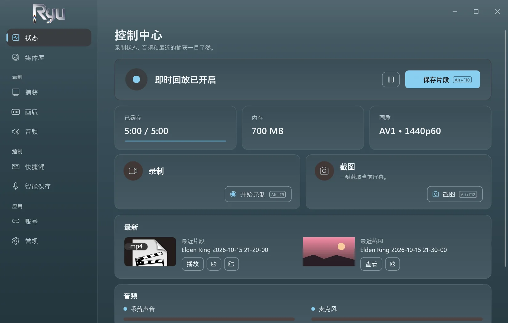
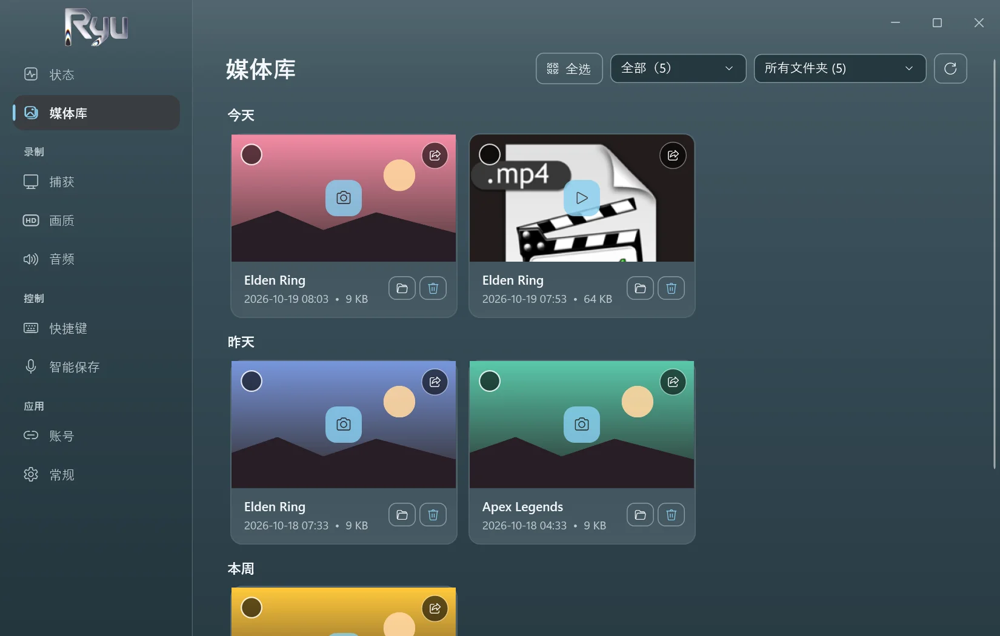
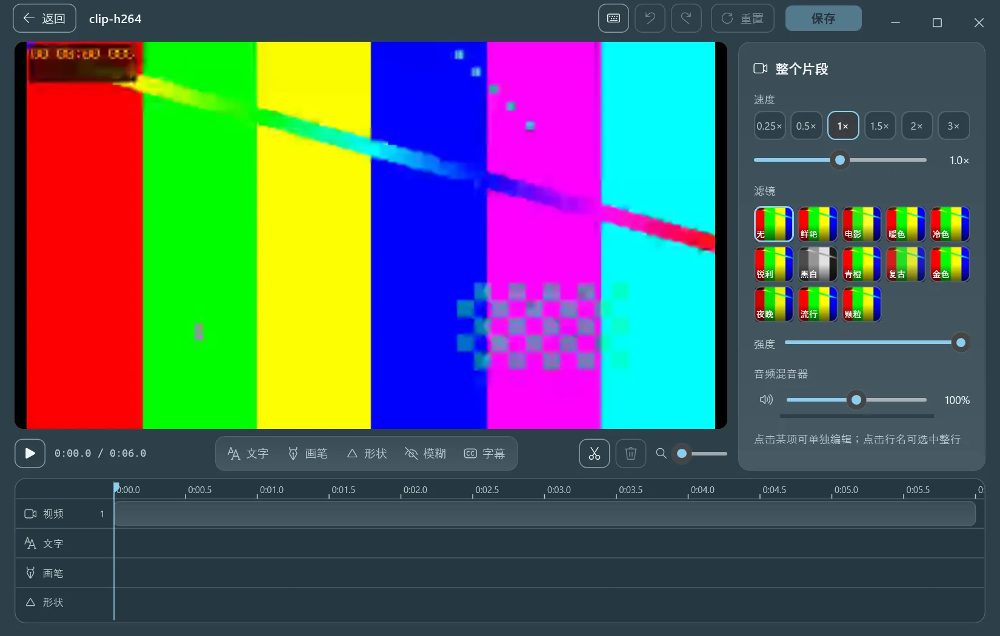
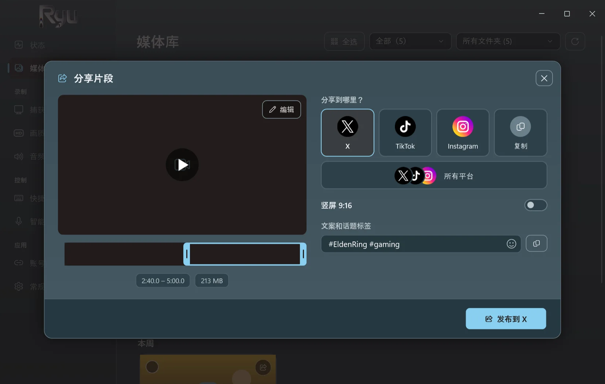
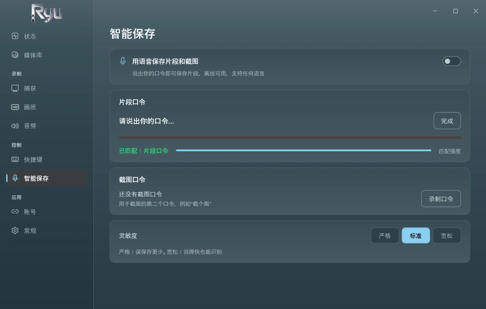
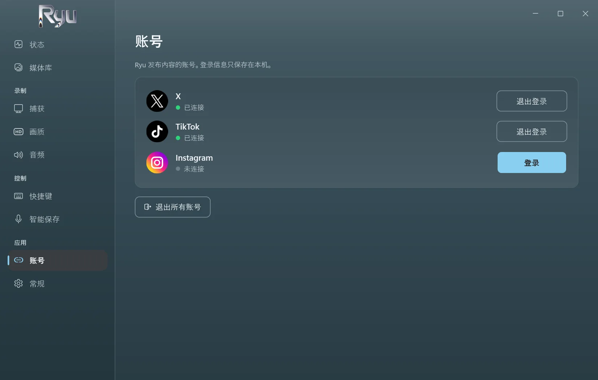

<p align="center">
  <picture>
    <source media="(prefers-color-scheme: dark)" srcset="../src/Ryu/Ui/Assets/ryu-logo.png">
    
  </picture>
</p>

<h3 align="center">为 Windows 游戏打造的即时回放。</h3>

<p align="center">
  按下按键或说出你的口令，最近五分钟就会被保存。<br>
  免费、开源、离线运行，轻巧到你会忘记它在运行。
</p>

<p align="center">
  <a href="https://github.com/D3N00N/Ryu-Replay/releases/latest"></a>
  
  
</p>

<p align="center">
  <a href="../README.md">English</a> ·
  <a href="README.ar.md">العربية</a> ·
  <b>简体中文</b> ·
  <a href="README.ru.md">Русский</a> ·
  <a href="README.es.md">Español</a> ·
  <a href="README.pt-BR.md">Português (Brasil)</a> ·
  <a href="README.de.md">Deutsch</a>
</p>

https://github.com/user-attachments/assets/c7afb475-f4a2-4356-acc5-327935e879e2

## 为什么选择 Ryu

- **不错过任何精彩瞬间。** Ryu 在内存中保留最近 15 秒到 20 分钟（默认 5 分钟）。按下 `Alt+F10`，它就成为一个片段。
- **智能保存。** 录下你自己的口令（任何语言都可以），之后只需说出它，即可保存片段或截图。完全离线运行。
- **轻巧。** 使用显卡录制。以 1440p60 AV1 运行游戏时实测：CPU 占用 0.4%，无丢帧。
- **就地编辑。** 剪辑、调速、添加文字、涂画、模糊，并在你自己的电脑上生成自动字幕。
- **一键分享。** 发布到 X、TikTok 和 Instagram，或用同一段文案同时发布到三个平台；也可以复制片段，随处粘贴。
- **注重隐私。** 无需账号，没有遥测。在你分享之前，片段始终留在你的电脑上。

## 截图

<table>
  <tr>
    <td width="50%"><p align="center"><sub>即时回放、录制和截图一目了然</sub></p></td>
    <td width="50%"><p align="center"><sub>所有片段和截图，按日期和游戏整理</sub></p></td>
  </tr>
  <tr>
    <td width="50%"><p align="center"><sub>编辑器，以及在本机生成的自动字幕</sub></p></td>
    <td width="50%"><p align="center"><sub>替你发布到 X、TikTok 和 Instagram</sub></p></td>
  </tr>
  <tr>
    <td width="50%"><p align="center"><sub>智能保存：说出你的口令即可保存</sub></p></td>
    <td width="50%"><p align="center"><sub>只需登录一次，登录信息只保存在你的电脑上</sub></p></td>
  </tr>
</table>

## 下载

1. 从[最新版本](https://github.com/D3N00N/Ryu-Replay/releases/latest)下载 **Ryu-Setup.exe**。
2. 运行它并按步骤操作：选择语言和安装文件夹（无需管理员权限），以及是否创建桌面快捷方式、是否随 Windows 启动 Ryu。
3. 开始游戏，精彩时刻出现时按下 `Alt+F10`。

Windows 可能会提示未知发布者（安装程序尚未签名）：选择 **更多信息**，然后选择 **仍要运行**。
更新在应用内完成，录制期间绝不会更新。卸载时会保留你的片段和设置。

**系统要求：** Windows 10（2004 或更高版本）或 Windows 11，64 位。建议使用带视频编码器的显卡（NVIDIA、AMD 或 Intel）。

## 功能

<details>
<summary>Ryu 的全部功能</summary>

- **捕获：** 全屏、单个窗口或游戏（自动识别），最高 4K，30 到 240 fps。
- **编码：** 在 NVIDIA (NVENC)、AMD (AMF) 或 Intel (Quick Sync) 上使用 AV1、HEVC 或 H.264，并以 x264 作为后备。
- **音频：** 系统声音和麦克风，可选分轨录制。
- **录制：** 用快捷键开始、暂停和停止；暂停过的录制仍是一个文件。
- **截图** 有独立的快捷键，与片段保存在一起。
- **媒体库：** 片段和截图按日期排列，可按游戏筛选，并可设置文件夹大小上限，最旧的文件会移到回收站。
- **编辑器：** 剪切与拼接、分段调整速度和声音、多种字体和样式的文字、自动字幕、涂画、形状、模糊、滤镜，以及截图裁剪。
- **自动字幕：** 在显卡上运行 Whisper。引擎和模型在你同意后只下载一次，可在设置中删除。
- **分享：** 通过各网站自己的页面发布到 X、TikTok、Instagram 或全部平台；可在帧条上剪辑时长，并裁成 9:16。
- **七种语言：** 英语、阿拉伯语、中文、俄语、西班牙语、葡萄牙语和德语。首次运行时跟随 Windows 语言。
- **安静：** 随 Windows 启动并驻留在托盘中；除非你开启，否则没有弹窗和声音。

</details>

## 隐私

- 没有遥测，没有数据分析，也没有 Ryu 账号。
- Ryu 只在你需要时联网：发布你分享的内容、一次性下载自动字幕，以及每天检查一次新版本（可以关闭）。
- 智能保存和自动字幕只在你的电脑上收听。

## 从源码构建

<details>
<summary>面向开发者</summary>

Ryu 是一个 .NET 10 应用（WPF 和 WinForms），内置 [OBS Studio](https://obsproject.com) 的引擎 **libobs**（只包含所需模块），并使用 FFmpeg 进行编辑和分享。

```powershell
.\tools\build-whisper.ps1               # once: the auto captions engine (needs the Vulkan SDK and VS Build Tools)
.\tools\release.ps1                     # the Setup, update files and source zip in releases\ (needs vpk 1.2.161)
dotnet run --project tests\Ryu.Tests # the tests
```

构建时会从已安装的 OBS Studio 复制 libobs 32.2.2。

</details>

## 许可证

Ryu 是自由软件，采用 [GNU 通用公共许可证 v2.0 或更高版本](../LICENSE)，与 libobs 的许可证相同。每个版本都附带完整源代码。第三方组件及其许可证列于 [THIRD-PARTY-NOTICES.md](../THIRD-PARTY-NOTICES.md)。

<sub>*Ryu*（καιρός）在希腊语中意为“*恰当的时刻*”。</sub>
